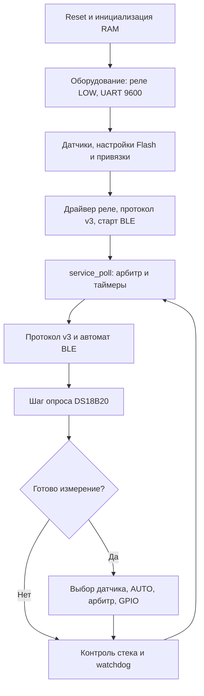

# F030 без сервисной консоли

Ветка: `dev/f030-no-service-console`.
Исходная версия сохранена первым коммитом в master.

Для F030 включён CLIMAT_NO_SERVICE_CONSOLE. Из компиляции исключены
текстовый парсер команд, его очередь, форматирование ответов и диагностический
режим PHONE TEST. Остаются общий арбитр, измерения, настройки и диспетчер
бинарного протокола v3. F767 сохраняет свою стендовую консоль.

PA5 не используется: GPIO не настраивается и не читается. USART1 PA9/PA10
всегда 9600 8N1; запуск BLE выполняется при каждом старте. Настройка, MANUAL,
привязки S1/S2 и SAVE доступны через протокол v3. K1..K4 — PA1..PA4 active HIGH.
Последняя страница 0x08003C00..0x08003FFF остаётся CONFIG (1 КиБ), без загрузочных
секций и без изменения формата настроек v5.

Проверки:
- F030: сборка и verify PASS; 10956/15360 Б программной Flash, свободно 4404 Б.
- RAM с резервом стека 2048 Б: 3040/4096 Б; свободно 1056 Б.
- Проверены отсутствие CONFIG в BIN, векторы, RAM Flash writer;
  дополнительно запрещены символы текстовой консоли в связанном ELF.
- F767: сборка PASS, 42452 Б; SHA256 совпадает с исходной v3.
- Обычные тесты: 16/16 PASS; compact: 16/16 PASS;
  no-console + compact: 16/16 PASS, включая SET_CONFIG, SAVE, загрузку после
  повторной инициализации, привязки S1/S2 и MANUAL через бинарный канал.
- Связанный драйвер F030: 256/256 переходов GPIO PASS в Unicorn.

Команды: targets/stm32f030f4/build.ps1; python build.py;
python tests/run_tests.py [--compact] [--no-console] --runtime DIR;
python tests/test_f030_relays.py DIR.

Артефакты: targets/stm32f030f4/build/climat_f030f4.bin и memory-report.json;
build/tests-no-console/results.json. Аппаратная проверка и прошивка устройства
в этой задаче не выполнялись.
