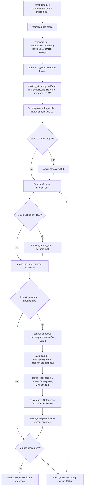

# Структура программы F030 — 02.11.2026

Актуальная рабочая копия: протокол v3, настройки Flash v5, выходы active HIGH.
Перечень ниже относится к исходникам производственной сборки F030 из build.ps1.
Код HAL/F767 и стендовые selftest-функции в этот перечень не включены.
static означает внутреннюю функцию модуля. Сигнатуры извлечены из определений C.

## Модули

| Модуль | Ответственность |
|---|---|
| targets/stm32f030f4/startup.c | Векторы, начальная инициализация RAM, Reset_Handler |
| targets/stm32f030f4/board.c | GPIO, 1-Wire, UART, Flash, watchdog, основной цикл |
| temperature_probe.c | Поиск DS18B20, привязки S1/S2, CRC8, температура, производная |
| auto_control.c | Запросы K1–K4 по Ton/H, S/R/Hrate и чередование вентиляторов |
| control_core.c | Арбитр: AUTO/MANUAL, аварии, резервирование, времена ON/OFF |
| service_console.c | Связь модулей, текстовые команды и диспетчер операций v3 |
| phone_link.c | Кадры v3, COBS, CRC16, последовательности и повторы |
| bt_boot.c | Неблокирующий автомат стартовой AT-настройки BLE |
| settings.c | Значения по умолчанию, сериализация v5, миграция, CRC32, SAVE |
| tiny_format.c | Компактное форматирование целых чисел и строк |

## Поток управления



service_poll также вызывает control_tick и применяет выходы на каждом проходе,
поэтому таймеры и MANUAL обслуживаются независимо от готовности измерения.
USART1_IRQHandler помещает входные байты в очереди; команды исполняются в основном
цикле. SysTick_Handler увеличивает миллисекундный счётчик.

Настройки сохраняются только по SAVE. Последняя страница Flash
0x08003C00..0x08003FFF (1 КиБ) исключена из программного образа;
код ограничен первыми 15 КиБ. Стек зарезервирован размером 2048 байт.

## Полный перечень определений функций

### targets/stm32f030f4/startup.c

```c
static void fault(void);
void Reset_Handler(void);
```

### targets/stm32f030f4/board.c

```c
static void watchdog(void);
static void fatal(void);
void SysTick_Handler(void);
static uint32_t now_ms(void);
static void delay_us(unsigned us);
static void low(void);
static void release(void);
static unsigned level(void);
static int ow_reset(void);
static void ow_write(unsigned bit);
static unsigned ow_read(void);
static int uart_send(const uint8_t *p, unsigned n);
static void uart_write(const uint8_t *p, unsigned n);
static void console(const char *p);
static int bt_send(void *context, const char *p);
static int bt_filter(uint8_t byte, uint32_t now);
void USART1_IRQHandler(void);
static void report(uint32_t now);
static unsigned stack_used(void);
static uint8_t relay_apply(uint8_t mask);
static int bt_status(const char *command);
static int flash_read(uint8_t *b);
static int flash_program(const uint8_t *record, uint32_t *elapsed);
static int flash_write(const uint8_t *b);
static void hardware_init(void);
int main(void);
```

### Core/Src/temperature_probe.c

```c
uint8_t probe_crc8(const uint8_t *data, size_t length);
int probe_decode(const uint8_t s[9], int16_t *raw16);
static void wr(TemperatureProbe *p, uint8_t v);
static uint8_t rd(TemperatureProbe *p);
static void match(TemperatureProbe *p, const uint8_t rom[8]);
static void fail(ProbeSensor *s, const char *why);
static int fail_all(TemperatureProbe *p, const char *why);
static void scan(TemperatureProbe *p);
static int32_t trend_rate(int32_t delta, uint32_t dt);
static void sample(ProbeSensor *s, int16_t value, uint32_t now);
uint32_t probe_trend_selftest(void);
void probe_init(TemperatureProbe *p, ProbeBus bus);
int probe_bindings_valid(const uint8_t rom[2][8]);
int probe_set_bindings(TemperatureProbe *p, const uint8_t rom[2][8]);
int probe_poll(TemperatureProbe *p, uint32_t now);
```

### Core/Src/auto_control.c

```c
void auto_config_write(const AutoConfig *a, uint8_t b[18]);
void auto_config_read(AutoConfig *a, const uint8_t b[18]);
void auto_reset(AutoControl *a);
int auto_configure(AutoControl *a, const AutoConfig *p);
static uint8_t heat_stage(unsigned was, int16_t t, int16_t on, int16_t hyst);
static uint8_t cool_stage(unsigned was, int16_t t, int16_t on, int16_t hyst);
static uint8_t rate_latch(uint8_t was, unsigned enabled, int32_t rate, int32_t on, uint16_t hyst);
uint8_t auto_sample(AutoControl *a, unsigned source, unsigned valid, int16_t raw16, unsigned trend_valid, int32_t rate_milli, uint8_t actual, uint32_t now);
```

### Core/Src/control_core.c

```c
static uint8_t increment(uint8_t n);
void control_init(ControlCore *c, uint32_t now);
void control_observe(ControlCore *c, unsigned v1, unsigned v2, uint32_t now);
void control_sample(ControlCore *c, unsigned v1, unsigned v2, uint32_t now);
void control_tick(ControlCore *c, uint32_t now);
void control_mode(ControlCore *c, unsigned manual, uint32_t now);
int control_relay(ControlCore *c, unsigned relay, unsigned on, uint32_t now);
```

### Core/Src/service_console.c

```c
static void apply_relays(void);
void service_set_relay_driver(uint8_t (*driver)(uint8_t));
static void tick(uint32_t now);
void service_set_bt_handler(int (*handler)(const char *));
void service_set_phone_filter(int (*filter)(uint8_t,uint32_t));
void service_device_name(uint8_t name[3]);
static void settings_current(Settings *s);
static void settings_apply(const Settings *s, uint32_t now);
static void set_mode(unsigned manual, uint32_t now);
static uint16_t u16(const uint8_t *p);
static void w16(uint8_t *p, uint16_t n);
static void w32(uint8_t *p, uint32_t n);
static void config_payload(const Settings *s, uint8_t *p);
static unsigned phone_dispatch(void *context, uint8_t op, const uint8_t *p, unsigned n, uint8_t *r, uint32_t now);
static void phone_send(void *context, const uint8_t *p, unsigned n);
void service_phone_init(void (*send)(const uint8_t *,unsigned));
void service_phone_byte(uint8_t b);
void service_phone_loss(void);
void service_phone_poll(uint32_t now);
static int hex_digit(char c);
void service_rx_byte(uint8_t b);
void service_rx_error(void);
unsigned service_stream_enabled(void);
void service_init(TemperatureProbe *p, void (*r)(uint32_t), void (*o)(const char *), SettingsBackend io);
void service_sample(uint32_t now);
static void status(uint32_t now);
static void auto_status(void);
static int auto_settings(const char *s);
static int number(const char *s, unsigned *n);
static void command(uint32_t now);
void service_poll(uint32_t now);
```

### Core/Src/phone_link.c

```c
uint16_t phone_crc16(const uint8_t *p, unsigned n);
unsigned phone_pack(uint8_t op, uint16_t seq, const uint8_t *p, unsigned n, uint8_t wire[PHONE_WIRE_MAX]);
unsigned phone_unstuff(const uint8_t *p, unsigned n, uint8_t *out);
void phone_init(PhoneLink *l, PhoneDispatch dispatch, PhoneSend send, void *context);
void phone_loss(PhoneLink *l);
void phone_tick(PhoneLink *l, uint32_t now);
static void frame(PhoneLink *l, uint32_t now);
void phone_feed(PhoneLink *l, uint8_t byte, uint32_t now);
```

### Core/Src/bt_boot.c

```c
unsigned bt_boot_busy(const BtBoot *b);
void bt_boot_init(BtBoot *b, const uint8_t name[3], uint32_t now, int (*send)(void *,const char *), void *context);
static int setting(unsigned state);
static void enter(BtBoot *b, unsigned state, uint32_t now);
static int line(const BtBoot *b, const char *prefix, const char *value);
static int value_present(const BtBoot *b, const char *prefix);
static void verify_after_write(BtBoot *b, uint32_t now);
static void response(BtBoot *b, uint32_t now);
void bt_boot_poll(BtBoot *b, uint32_t now);
int bt_boot_byte(BtBoot *b, uint8_t byte, uint32_t now);
```

### Core/Src/settings.c

```c
static uint16_t get16(const uint8_t *p);
static uint32_t get32(const uint8_t *p);
static void put16(uint8_t *p, uint16_t v);
static void put32(uint8_t *p, uint32_t v);
uint32_t settings_crc32(const uint8_t *p, size_t n);
void settings_defaults(Settings *s);
static int valid(const Settings *s);
int settings_encode(const Settings *s, uint8_t b[SETTINGS_SIZE]);
SettingsResult settings_decode(const uint8_t b[SETTINGS_SIZE], Settings *s);
SettingsResult settings_load(SettingsBackend io, Settings *s);
SettingsResult settings_save(SettingsBackend io, const Settings *s, unsigned *unchanged);
```

### Core/Src/tiny_format.c

```c
static void put(char *b, size_t size, unsigned *used, char c);
int tiny_snprintf(char *b, size_t size, const char *fmt, ...);
```

Всего определений: 120.
